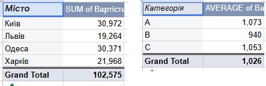
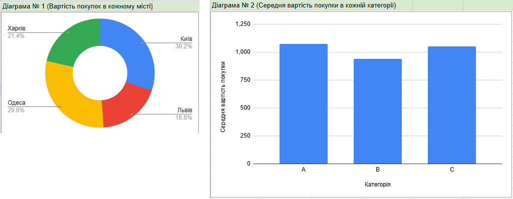
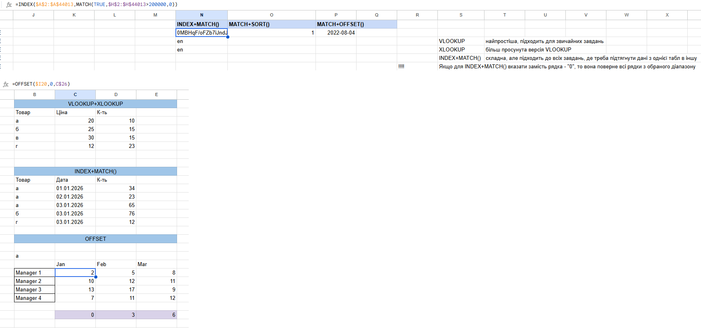
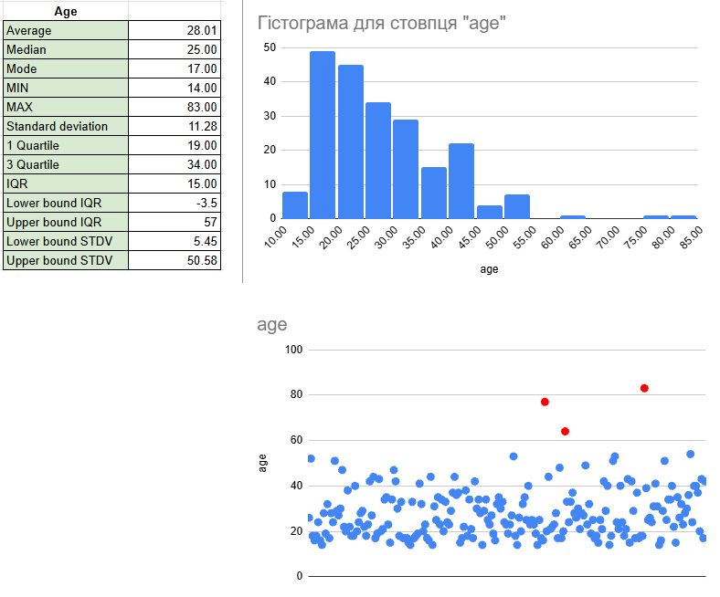
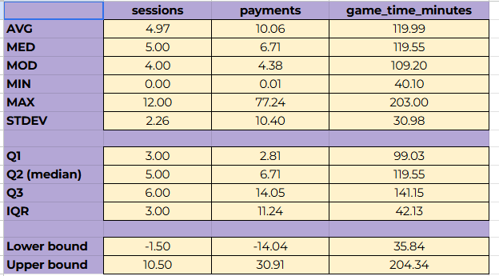
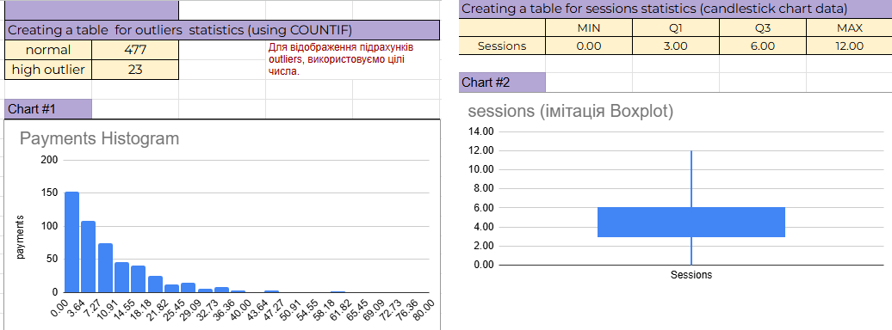

# Google Sheets Analytics — навчальні роботи (GoIT, Data Analyst)

Три навчальні роботи з курсу **Data Analyst (IT School GoIT, 2026)**, виконані в Google Sheets: зведені таблиці й діаграми, пошук і об'єднання даних на ~44 тис. рядків, описова статистика та виявлення викидів.
Дані — навчальні датасети курсу. Таблиці відкриті лише для перегляду.

*Three Google Sheets assignments from the GoIT Data Analyst course (2026): pivot tables and charts, lookups on ~44k rows, descriptive statistics and outlier detection. Course datasets, view-only links.*

---

## 1. Зведені таблиці, сортування, діаграми

**Таблиця:** [Google Sheets: зведені таблиці, сортування, діаграми](https://docs.google.com/spreadsheets/d/1CLpdMaRA2qt0klDoMwK8CSCFFB1t-qseYLric56dvYM/edit?usp=sharing)

**Задача:** проаналізувати 100 покупок клієнтів (категорія товару A/B/C, місто, дата, статус клієнта).

**Що зроблено:**
- підсумкові показники: загальна вартість покупок, найбільша покупка, кількість клієнтів;
- сортування таблиці покупок за категорією та вартістю;
- зведена таблиця 1 — сума покупок по містах;
- зведена таблиця 2 — середня вартість покупки по категоріях;
- діаграми: кільцева (частка міст у сумі покупок) і стовпчикова (середня вартість по категоріях).

**Результат:**
- загальна вартість — 102 575, найбільша покупка — 1 793, клієнтів — 100;
- найбільша сума покупок — Київ (30 972) та Одеса (30 371), найменша — Львів (19 264);
- середня покупка найвища в категорії A (1 073), найнижча — у B (940).

---

## 2. Пошук і об'єднання даних: VLOOKUP, XLOOKUP, INDEX + MATCH (~44 тис. рядків)

**Таблиця:** [Google Sheets: VLOOKUP, XLOOKUP, INDEX-MATCH, SPLIT, ARRAYFORMULA](https://docs.google.com/spreadsheets/d/16dPxskvqrPe6tZch1Fq9tZSm3bT9f3I8fpQhTCFpx0Q/edit?usp=sharing)

**Задача:** об'єднати журнал ігрової активності (44 012 рядків: користувач, дата, гра, активність, час у секундах) з довідниками типів активностей і профілями 216 активних користувачів.

**Що зроблено:**
- збагачення журналу активності довідниками: VLOOKUP, XLOOKUP, INDEX + MATCH;
- MATCH + SORT, MATCH + OFFSET, OFFSET — пошук за позицією і вибірка діапазонів;
- SPLIT і ARRAYFORMULA — розбиття полів і обробка цілих стовпців однією формулою;
- порівняння VLOOKUP / XLOOKUP / INDEX + MATCH на окремих прикладах (обмеження VLOOKUP: ключ має бути в першому стовпці діапазону);
- описова статистика віку користувачів і виявлення викидів двома способами (межі IQR та ±2 стандартні відхилення), гістограма й точкова діаграма з виділеними викидами.

**Результат (вік, 216 користувачів):** середнє — 28,01, медіана — 25, мода — 17, мін./макс. — 14/83, Q1/Q3 — 19/34, IQR — 15; верхня межа викидів за IQR — 57, за стандартним відхиленням — 50,58.

---

## 3. Описова статистика і виявлення викидів

**Таблиця:** [Google Sheets: статистика й виявлення викидів](https://docs.google.com/spreadsheets/d/16edQN-qEYPy9hUOfiFTmail2ew4Lh2lmZw3bTMGscn4/edit?usp=sharing)

**Задача:** описати поведінку 500 гравців (кількість сесій, платежі, час у грі) і знайти викиди в платежах.

**Що зроблено:**
- AVERAGE, MEDIAN, MODE, MIN, MAX, STDEV, QUARTILE і IQR для трьох метрик;
- межі викидів за правилом 1,5 × IQR; позначка кожного рядка через IF («normal» / «high outlier»);
- підрахунок викидів через COUNTIF;
- гістограма платежів і діаграма розподілу сесій (імітація boxplot через свічкову діаграму);
- письмові висновки на аркуші Explanation.

**Результат:**
- середній платіж (10,06) помітно вищий за медіану (6,71) — розподіл зміщений вправо через великі платежі;
- знайдено 23 високі викиди в платежах (верхня межа — 30,91), низьких викидів немає;
- середня кількість сесій — 4,97, медіана — 5, найчастіше — 4.

---

**Інструменти:** Google Sheets — зведені таблиці, діаграми, сортування, VLOOKUP, XLOOKUP, INDEX + MATCH, OFFSET, SPLIT, ARRAYFORMULA, IF, COUNTIF, UNIQUE, статистичні функції.
**Автор:** Володимир Ворошилов · [GitHub](https://github.com/VoroshylovV) · [LinkedIn](https://www.linkedin.com/in/voroshylov-volodymyr/)
